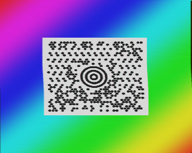
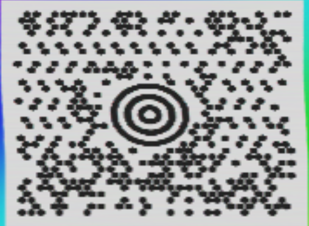
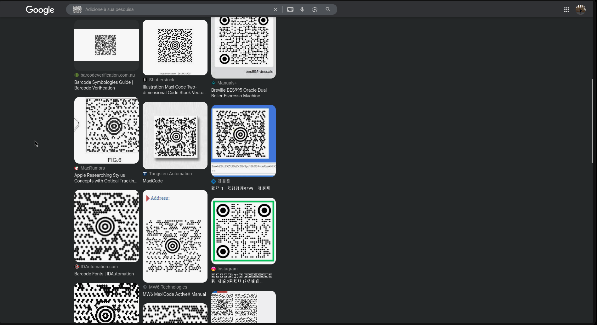

The audio is an SSTV (Slow Scan Television) signal that encodes an image. To decode the image, we can use something like https://github.com/colaclanth/sstv.



The decoded image contains at the center a MaxiCode that is a type of 2D barcode. 



We can see what it is by reverse image searching the center part of the image.



Decoding the MaxiCode using something like https://www.dynamsoft.com/barcode-reader/barcode-types/maxicode/ gives us the final flag:

```
STT{D1d_y0u_H@d_FuN?}
```

The challenge seems easy once you know the steps but nobody knows about SSTV or MaxiCode by default, so it requires some research to figure out what to do with the audio and the image.