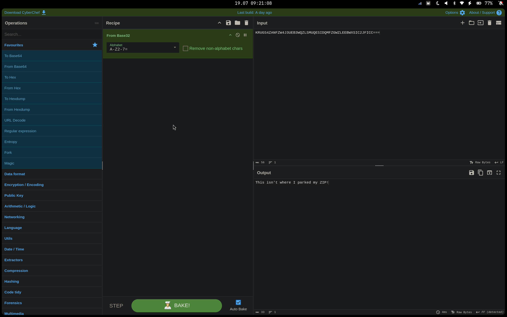
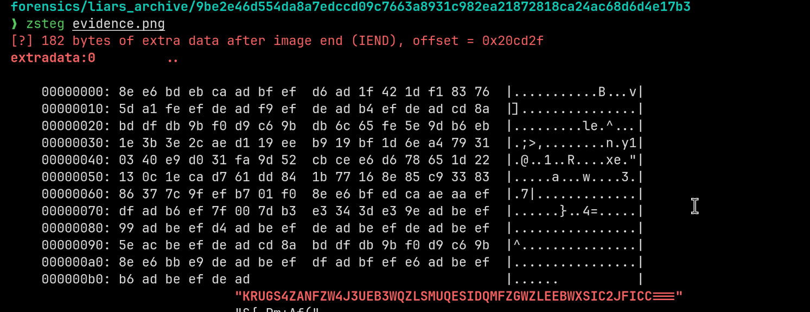
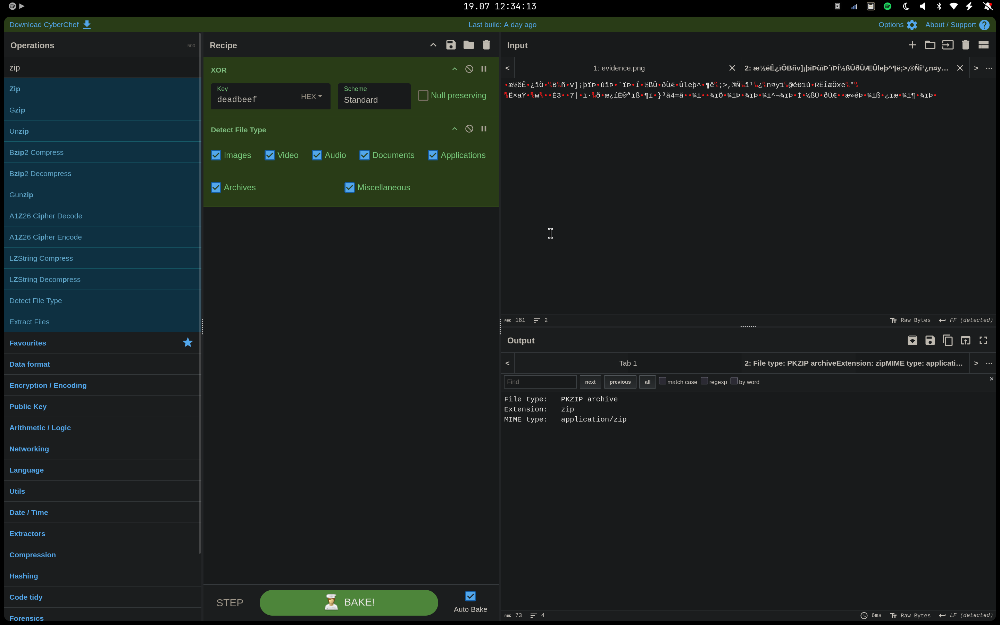
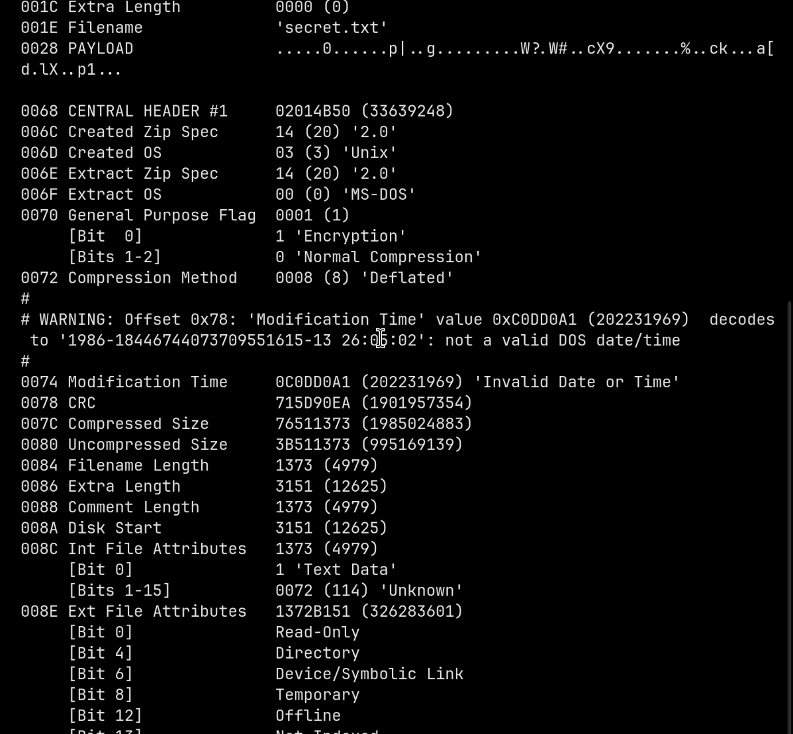

forensics/liars_archive/9be2e46d554da8a7edccd09c7663a8931c982ea21872818ca24ac68d6d4e17b3
❯ exiftool evidence.png
ExifTool Version Number         : 13.59
File Name                       : evidence.png
Directory                       : .
File Size                       : 2.1 MB
File Modification Date/Time     : 2026:06:03 21:45:02+01:00
File Access Date/Time           : 0000:00:00 00:00:00
File Inode Change Date/Time     : 2026:07:19 09:18:32+01:00
File Permissions                : -rw-r--r--
File Type                       : PNG
File Type Extension             : png
MIME Type                       : image/png
Image Width                     : 1536
Image Height                    : 1024
Bit Depth                       : 8
Color Type                      : RGB
Compression                     : Deflate/Inflate
Filter                          : Adaptive
Interlace                       : Noninterlaced
Warning                         : [minor] Text/EXIF chunk(s) found after PNG IDAT (may be ignored by some readers)
Comment                         : KRUGS4ZANFZW4J3UEB3WQZLSMUQESIDQMFZGWZLEEBWXSIC2JFICC===
Image Size                      : 1536x1024
Megapixels                      : 1.6

This isn't where I parked my ZIP!

forensics/liars_archive/9be2e46d554da8a7edccd09c7663a8931c982ea21872818ca24ac68d6d4e17b3
❯ zipinfo download.zip
Archive:  download.zip
[download.zip]
  End-of-central-directory signature not found.  Either this file is not
  a zipfile, or it constitutes one disk of a multi-part archive.  In the
  latter case the central directory and zipfile comment will be found on
  the last disk(s) of this archive.
zipinfo:  cannot find zipfile directory in one of download.zip or
          download.zip.zip, and cannot find download.zip.ZIP, period.

forensics/liars_archive/9be2e46d554da8a7edccd09c7663a8931c982ea21872818ca24ac68d6d4e17b3
❯ zipdetails download.zip
#
# FATAL: No Zip metadata found at end of file
#        Try running with --walk' or '--scan' options .
#

forensics/liars_archive/9be2e46d554da8a7edccd09c7663a8931c982ea21872818ca24ac68d6d4e17b3
❯

0016 Uncompressed Size     00000047 (71)
001A Filename Length       000A (10)
001C Extra Length          0000 (0)
001E Filename              'secret.txt'
0028 PAYLOAD               .....0......p|..g.........W?.W#..cX9.......%..ck...a[d.lX..p1...

0068 CENTRAL HEADER #1     02014B50 (33639248)
006C Created Zip Spec      14 (20) '2.0'
006D Created OS            03 (3) 'Unix'
006E Extract Zip Spec      14 (20) '2.0'
006F Extract OS            00 (0) 'MS-DOS'
0070 General Purpose Flag  0001 (1)
     [Bit  0]              1 'Encryption'
     [Bits 1-2]            0 'Normal Compression'
0072 Compression Method    0008 (8) 'Deflated'
#
# WARNING: Offset 0x78: 'Modification Time' value 0xC0DD0A1 (202231969)  decodes to '1986-18446744073709551615-13 26:05:02': not a valid DOS date/time
#
0074 Modification Time     0C0DD0A1 (202231969) 'Invalid Date or Time'
0078 CRC                   715D90EA (1901957354)
007C Compressed Size       76511373 (1985024883)
0080 Uncompressed Size

forensics/liars_archive/9be2e46d554da8a7edccd09c7663a8931c982ea21872818ca24ac68d6d4e17b3
❯ zipdetails --scan download\ \(Copy\).zip

0000 LOCAL HEADER #1       04034B50 (67324752)
0004 Extract Zip Spec      14 (20) '2.0'
0005 Extract OS            00 (0) 'MS-DOS'
0006 General Purpose Flag  0000 (0)
     [Bits 1-2]            0 'Normal Compression'
0008 Compression Method    0008 (8) 'Deflated'
000A Modification Time     5CC3ADA1 (1556327841) 'Wed Jun  3 22:45:02 2026'
000E CRC                   0C83993D (209951037)
0012 Compressed Size       00000040 (64)
0016 Uncompressed Size     00000047 (71)
001A Filename Length       000A (10)
001C Extra Length          0000 (0)
001E Filename              'secret.txt'
0028 PAYLOAD               .....0......p|..g.........W?.W#..cX9.......%..ck...a[d.lX..p1...
