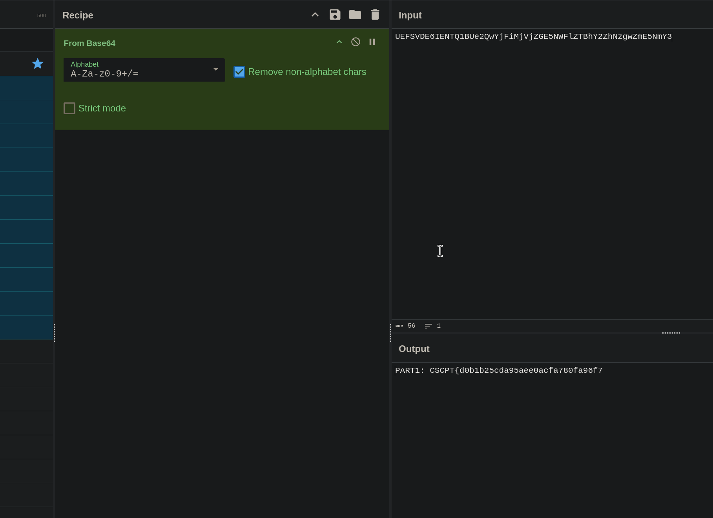
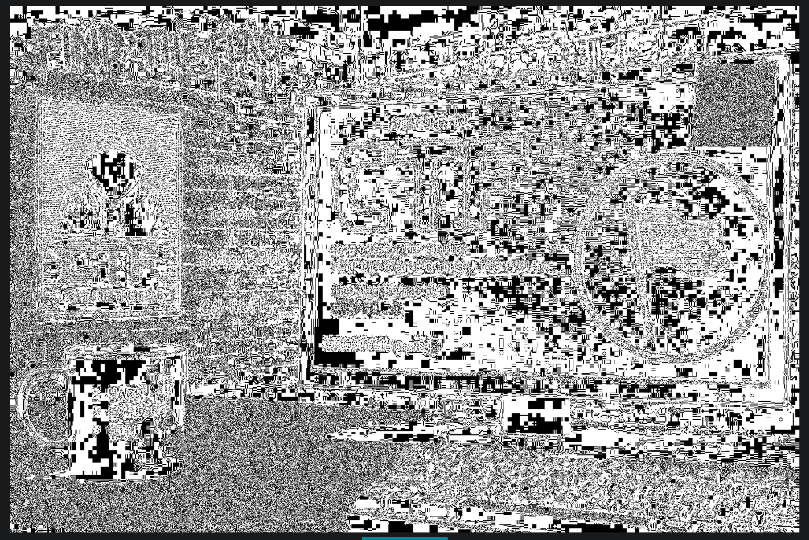
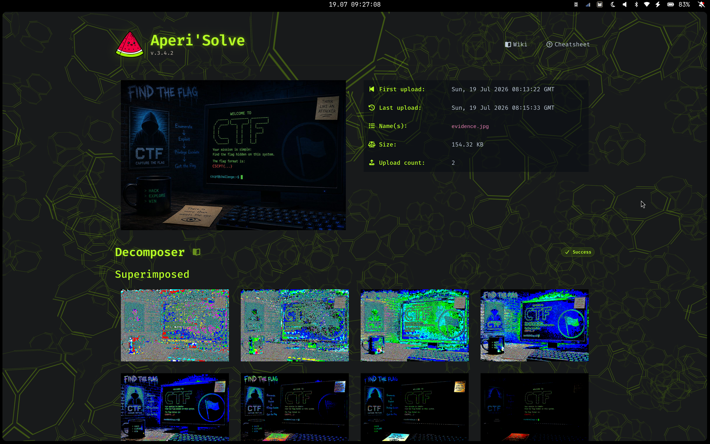
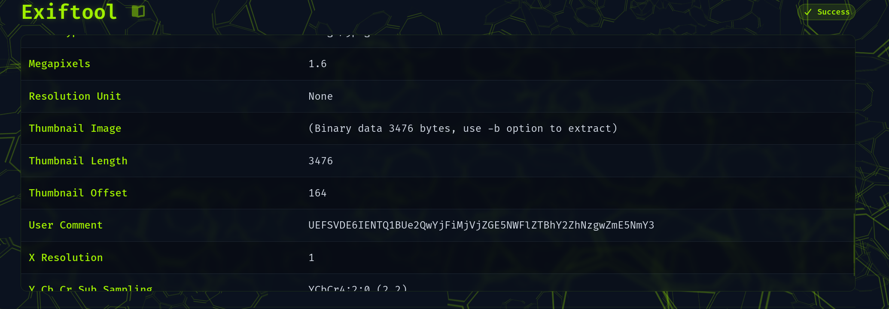
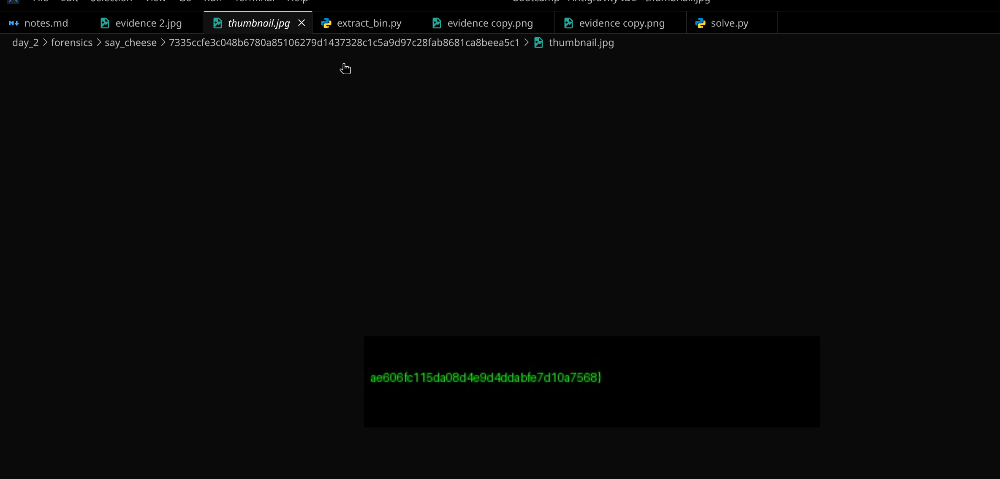

forensics/say_cheese/7335ccfe3c048b6780a85106279d1437328c1c5a9d97c28fab8681ca8beea5c1 
❯ exiftool evidence.jpg         
ExifTool Version Number         : 13.59
File Name                       : evidence.jpg
Directory                       : .
File Size                       : 158 kB
File Modification Date/Time     : 2026:06:03 21:41:42+01:00
File Access Date/Time           : 0000:00:00 00:00:00
File Inode Change Date/Time     : 2026:07:19 09:08:29+01:00
File Permissions                : -rw-r--r--
File Type                       : JPEG
File Type Extension             : jpg
MIME Type                       : image/jpeg
JFIF Version                    : 1.01
Resolution Unit                 : None
X Resolution                    : 1
Y Resolution                    : 1
Exif Byte Order                 : Big-endian (Motorola, MM)
User Comment                    : UEFSVDE6IENTQ1BUe2QwYjFiMjVjZGE5NWFlZTBhY2ZhNzgwZmE5NmY3
Thumbnail Offset                : 164
Thumbnail Length                : 3476
Image Width                     : 1536
Image Height                    : 1024
Encoding Process                : Baseline DCT, Huffman coding
Bits Per Sample                 : 8
Color Components                : 3
Y Cb Cr Sub Sampling            : YCbCr4:2:0 (2 2)
Image Size                      : 1536x1024
Megapixels                      : 1.6
Thumbnail Image                 : (Binary data 3476 bytes, use -b option to extract)

PART1: CSCPT{d0b1b25cda95aee0acfa780fa96f7

forensics/say_cheese/7335ccfe3c048b6780a85106279d1437328c1c5a9d97c28fab8681ca8beea5c1 
❯ stegseek evidence.jpg ../../../rockyou.txt
StegSeek 0.6 - https://github.com/RickdeJager/StegSeek

[i] Progress: 99.44% (132.7 MB)           
[!] error: Could not find a valid passphrase.

forensics/say_cheese/7335ccfe3c048b6780a85106279d1437328c1c5a9d97c28fab8681ca8beea5c1
❯ ./jsteg-linux-amd64 reveal evidence.jpg
jpeg does not contain hidden data

forensics/say_cheese/7335ccfe3c048b6780a85106279d1437328c1c5a9d97c28fab8681ca8beea5c1
❯ exiftool -b -ThumbnailImage evidence.jpg > thumbnail.jpg

